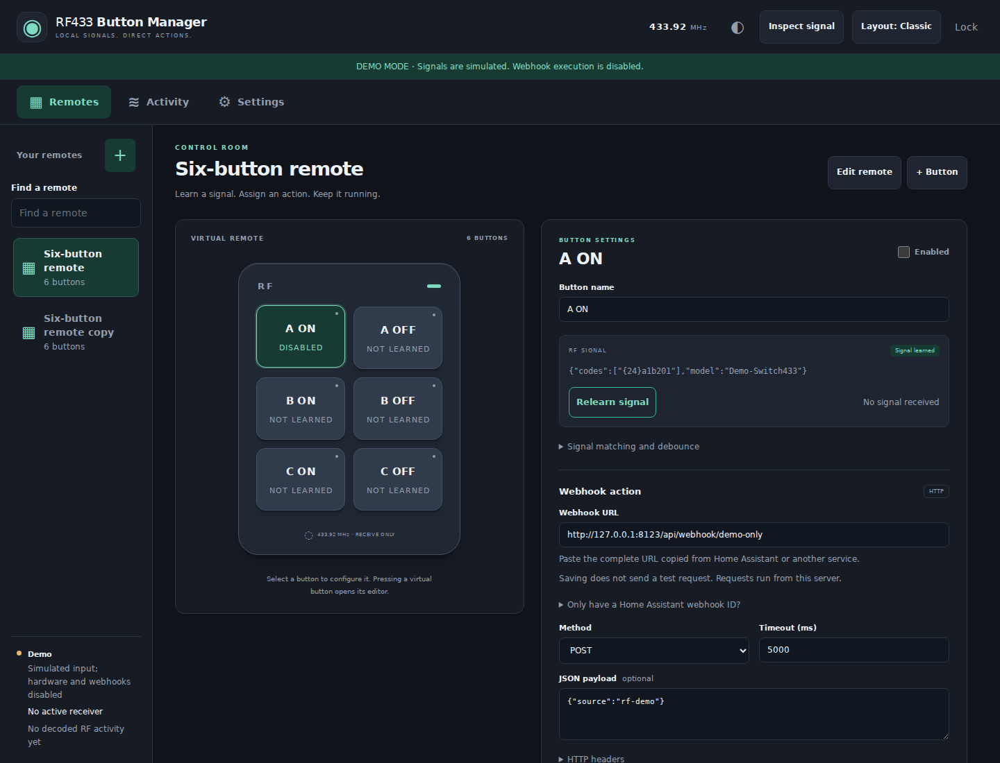

# RF433 Button Manager

**Use 433 MHz wireless buttons and remotes to trigger Home Assistant automations.**

RF433 Button Manager is an open-source Linux application that receives supported
**433.92 MHz** button signals through an **RTL-SDR USB receiver** and `rtl_433`.
Learn a button in your browser, assign a webhook URL, and use the physical button
to turn on a light, activate a scene or run another automation.

A webhook is a private web address that starts an automation when the app calls
it. Home Assistant controls the devices; RF433 Button Manager connects the radio
button press to that automation. Other services with HTTP webhooks can also be used.

[Download 0.4.0](https://github.com/ninoleto/rf433-button-manager/releases/tag/v0.4.0)
· [First installation](docs/GETTING-STARTED.md)
· [Update an existing installation](docs/UPGRADING.md)
· [Button compatibility](docs/COMPATIBILITY.md)

## Why this exists

An inexpensive wireless wall switch or remote can be useful even when it has no
direct Home Assistant integration. This project brings receiving, inspecting,
learning and assigning supported buttons into one browser interface, so you do
not need to write and maintain your own receiver and webhook scripts.

Install it on an always-on Linux computer, connect a compatible receiver and
antenna, then configure it from a PC or phone. The service keeps listening and
sending assigned webhooks after you close the browser. RF433 Button Manager
requires no MQTT broker, Docker container or cloud account.

The open-source [rtl_433](https://github.com/merbanan/rtl_433) project decodes the
radio transmissions. RF433 Button Manager adds button learning, saved assignments,
receiver management, reception diagnostics and HTTP actions.

## What you need

| Item | Where it belongs |
| --- | --- |
| Always-on Linux x86_64 computer with systemd and udev | Runs the receiver software and this app. The supplied ZIP is for 64-bit Intel/AMD PCs, not ARM/Raspberry Pi hardware. |
| Compatible RTL-SDR USB receiver and antenna | Connected to that Linux computer. |
| Supported 433.92 MHz wireless button or remote | Sends the physical button press. Compatibility depends on its signal format. |
| `rtl_433`, installed separately | On the same Linux computer as the USB receiver. Physical testing used version 23.11. |
| Home Assistant, or another service accepting HTTP webhooks | Already running and reachable from the Linux computer. |
| Web browser | On your PC or phone for setup and management. |

The installer uses systemd to run the app in the background and udev for USB
permissions. Setup also needs Python 3, `unzip` and a Linux account with `sudo`
access. The ZIP includes a ready-to-run executable; Go, Node.js and compilation
are not needed to install it.

**A “433 MHz” label alone does not guarantee compatibility.** Use **Inspect signal**
to investigate a button before assigning it. The app receives radio signals; it
cannot transmit RF commands to sockets or other devices. It does not provide
general rolling-code or encrypted-signal support. See the
[compatibility and inspection guide](docs/COMPATIBILITY.md).

## What must be installed, and where?

**Install two separate programs on the Linux computer with the USB receiver:**

1. **Install `rtl_433` first.** It reads the receiver and decodes supported
   transmissions. Our ZIP does not contain it, and our installer does not install
   it. If it is missing on a Debian/Ubuntu-based system such as Zorin, run
   `sudo apt install rtl-433` in that computer's terminal. The package name uses
   a hyphen (`rtl-433`); the executable uses an underscore (`rtl_433`). Follow the
   [decoder installation and checking steps](docs/GETTING-STARTED.md#install-the-required-decoder).
   Keep an existing working installation.
2. **Then install RF433 Button Manager** on the same computer using the
   [setup guide](docs/GETTING-STARTED.md). After setup, the app starts and manages
   `rtl_433` automatically. You do not start a separate decoder process each time.

For Home Assistant actions, **Home Assistant must already be installed and
working**. It may run on the same Linux computer, another PC, a NAS or a Raspberry
Pi on your network. You do not need to move or reinstall it.

Home Assistant's built-in **Webhook** trigger is enough. No custom integration,
add-on, HACS component, MQTT broker or Home Assistant access token is needed for
this connection. This method triggers an automation; it does not automatically
create an RF device or entity in Home Assistant.

Nothing needs to be installed on the Windows PC or phone used to open the app's
web interface. Initial Linux installation uses terminal commands; everyday
learning and webhook setup happen in the browser.

## How we use it

In the maintainer's setup, a mini PC running Zorin OS hosts the USB receiver,
`rtl_433`, RF433 Button Manager and Home Assistant. Buttons are configured from a
Windows PC or phone using a browser. The mini PC handles reception and actions
with the browser closed. Zorin itself is not a requirement; the supplied package
targets Linux x86_64 with systemd and udev.

## Connect a button to Home Assistant

For example, use a wireless wall button to turn on your living-room lights:

1. Install the two programs above, open RF433 Button Manager and log in with its
   **management token**. Check that the receiver is connected.
2. In Home Assistant, create an automation with a **Webhook** trigger and an
   action that turns on the chosen light. Save and enable the automation.
3. In RF433 Button Manager, create a remote, select an on-screen button and choose
   **Learn signal**. Follow the prompts for three separate physical presses, then
   choose **Confirm and save**.
4. Paste the automation's **complete webhook URL** into **Webhook URL** and
   select **POST**. Choose **Save button**, or **Save & allow destination** if
   asked to approve the Home Assistant address. Saving does not run the automation.
5. When ready for the light to turn on, choose **Test saved action** and confirm
   **Send test**. After a successful test, turn on **Enabled**, choose **Save button**
   again and press the physical button.

The [complete walkthrough](docs/GETTING-STARTED.md#learn-a-button-and-connect-home-assistant)
explains each screen, how to use a webhook ID when you do not have the full URL,
and how to investigate an action that did not run. Keep webhook URLs private;
the app's management token is a separate credential for its own login screen.

## What it provides

- Multiple remotes with editable names and button counts, including an A/B/C ON/OFF layout.
- Browser-based learning and relearning with three separate matching presses and confirmation.
- **Inspect signal** for checking a button without saving an action; learning and inspection pause webhook actions.
- Per-button POST/GET webhooks with optional JSON, headers, timeout and an explicit test action.
- An activity monitor, recognized-press counts, signal observations and optional normal-use recordings.
- Light/dark themes, Classic and Unified desktop layouts, mobile navigation and touch controls.
- Token-protected management, configuration backup/restore and supervised receiver operation.

Only one selected RTL-SDR is used at a time. **Settings → Receiver device** lets
you choose a connected receiver by unique serial. See
[receiver selection](docs/RECEIVERS.md) for limitations with multiple or
indistinguishable tuners. [Learning details](docs/LEARNING.md) describe supported
fixed-code OOK PWM/PPM/PCM discovery and existing rtl_433 button decoders.

## What is new in 0.4.0

- Improved recognition of supported fixed-code signals, including matching
  verified equivalent decoder reports to the same saved button.
- Reception diagnostics and optional recordings during normal use, with actions
  continuing while recording.
- Configurable local-network HTTP or HTTPS access, certificate setup and
  management-token replacement. Localhost remains available on the server.
  Network changes must be tested and confirmed within three minutes or rolled back.
- Larger receiver/address pickers, a light/dark switch, and minus, plus and Reset
  controls. Method and Timeout are stacked on desktop and mobile.
- **24-hour local time** throughout the interface, such as `22:35`.
- An updater that preserves mappings, webhooks, settings, token and enabled flags,
  including migration from older `rf-button-manager` installations.

See the [0.4.0 release notes](docs/RELEASE-0.4.0.md),
[network guide](docs/NETWORK.md) and [upgrade guide](docs/UPGRADING.md).
Existing test.6 mappings can be kept; no relearning is required for this update.

## Compatibility and testing

Physical testing has used **Zorin OS 18.1**, one **RTL2838/R820T receiver** and
**rtl_433 23.11**. The maintainer's setup has nine configured button assignments;
the latest detailed trials exercised one six-button remote. He reports the best
results so far on his equipment and has chosen to publish **0.4.0 as a regular
release**.

Occasional missed presses were still observed, and their remaining causes are
not fully established. Other receiver/remote combinations, physical multi-tuner
operation, USB/hub recovery and a formal extended soak remain unverified. No
universal compatibility or reception percentage is claimed.

The release passed automated software checks, browser tests and recorded-signal
replay checks. These are separate from physical testing. See the
[hardware observations](docs/HARDWARE-TESTS.md),
[compatibility guide](docs/COMPATIBILITY.md) and
[final software audit](docs/FINAL-AUDIT-0.4.md) for the evidence and limits.

A **Webhook accepted (HTTP 200)** event means the request was accepted; it does
not independently confirm the light or device changed state. Diagnostic exports
exclude app credentials and webhook settings but contain radio identifiers and
nearby RF traffic; review them before sharing.

## Download and first installation

Download both files from [release 0.4.0](https://github.com/ninoleto/rf433-button-manager/releases/tag/v0.4.0)
to the same folder on the Linux computer with your USB receiver:

- **rf433-button-manager-0.4.0-linux-amd64.zip** — executable, source, Git history, documentation and dependency notices.
- **rf433-button-manager-0.4.0-linux-amd64.zip.sha256** — the download checksum.

Choose these assets rather than GitHub's automatic **Source code** downloads,
which do not contain the executable. Follow the
[step-by-step installation guide](docs/GETTING-STARTED.md) to verify both the
archive and its included `SHA256SUMS`, inspect the installation plan and install.

The extracted folder, executable and service now use **`rf433-button-manager`**.
Current state lives in `/var/lib/rf433-button-manager/`; the environment file is
`/etc/rf433-button-manager/manager.env`. The updater recognizes the old
`rf-button-manager` names and migrates a supported managed installation.

## Update an existing installation with a prebuilt package

Leave the existing service running. Finish or cancel learning/inspection and
any pending network change, then follow [UPGRADING.md](docs/UPGRADING.md).
It provides the complete download-verification, extraction, preview and apply commands.

The updater records and temporarily disables enabled actions, backs up stopped
state, installs the supplied executable and verifies the **running service's**
version and saved configuration. It then restores the original enabled flags.
A failed verification attempts rollback; keep the printed snapshot path.
The updater sends no test webhook and performs no USB reset.

Wait for **Update verified**, refresh the browser and check **0.4.0**, your remotes
and receiver status. The existing app URL and login token are preserved. Downloading
or extracting a ZIP alone does not update the running service.

## First login: where is my token?

The app creates its own login token on the Linux server during first startup.
Open a terminal **on that server**, or connect to it by SSH, and run:

```sh
sudo cat /var/lib/rf433-button-manager/management.token
```

Copy the printed token into **Management token** on the login screen and select
**Connect**. This is not a Home Assistant access token or webhook ID. Keep it
private. Reboots and updates preserve it. **Settings → Management token → Replace
token** creates a new token and revokes the old one.

If you run from source with a custom `--data-dir`, the token is in that folder
instead. If the installed token file is missing, check that installation completed
and the service is running; do not create an empty token file or disable authentication.

## AI-assisted development and contributing

This community project was built iteratively with AI coding agents and hands-on
testing by its owner — an approach often called **“vibe coding.”** It is shared
under the [MIT license](LICENSE) so others can inspect, improve and fork it.
The documented checks are not an independent certification of compatibility.
Bug reports, code review and results from additional hardware are welcome.

Developers and AI coding agents should start with [AGENTS.md](AGENTS.md), the
[developer guide](docs/DEVELOPMENT.md), [architecture](docs/ARCHITECTURE.md) and
[contribution guide](CONTRIBUTING.md). These explain how to extend the app,
preserve existing data and report what has actually been verified.



[Mobile preview](docs/screenshots/mobile.png). These historical 0.1.0-dev screenshots
use synthetic data; they do not show every 0.4.0 control or establish RF compatibility.

## Build and verify from source

Build on Linux with **Go 1.27.3**, Git, Make, Bash and Python 3.12. The frontend controller tests
in `make check` additionally use Node.js 20 or later (no npm packages). The embedded frontend needs no Node
build or network-hosted assets. Tests with the race detector require a C compiler;
the release executable uses pure-Go SQLite and is built with `CGO_ENABLED=0`.

```sh
git clone https://github.com/ninoleto/rf433-button-manager.git
cd rf433-button-manager
export GOTOOLCHAIN=local
go mod download
go mod verify
make check
make build
./bin/rf433-button-manager --version
```

`rtl_433` is also needed for the offline pulse replay integration tests (CI installs
it). Those tests never open USB; without it they report a skip.

`make test` runs uncached race-enabled tests with a two-minute timeout per package.
Use `make test TEST_PACKAGES=./internal/receiver` for a targeted check, or override
`TEST_FLAGS` deliberately. `make test-deploy` verifies shell syntax and dry-run
behavior without installing anything. These checks do not use production data or
establish physical receiver behavior.

`go.mod` and `go.sum` pin the dependency graph and checksums. `make build` uses a
fixed target (`linux/amd64`), strips machine paths/build IDs and excludes VCS metadata.
Reproduce a binary with the same commit, toolchain and command; verify it with
`sha256sum bin/rf433-button-manager`. Dependency downloads require internet access on
the build machine. Runtime decoding still uses an installed `rtl_433` executable.

## First local run

```sh
./bin/rf433-button-manager --data-dir ./rf-data --listen 127.0.0.1:8787 --rtl433 /usr/bin/rtl_433
```

Open `http://127.0.0.1:8787` and enter the token from
`rf-data/management.token`. Keep the token private. A missing receiver is reported;
demo data is never substituted automatically. Without explicit decoder settings,
rtl_433 uses its default protocols. Learn discovers supported unknown PWM/PPM/PCM
profiles automatically; a connected receiver alone does not prove a button decoded.

For an interface preview without radio hardware, use a **separate** data directory:

```sh
./bin/rf433-button-manager --demo --data-dir ./demo-data
```

Demo mode explicitly labels simulated receiver data, generates synthetic
`Switch433` events every five seconds and disables all real webhook execution.
It cannot verify your radio, decoder or Home Assistant installation.

1. Check receiver status. Select its unique serial in Settings if necessary.
   Normal learning does not require custom decoder settings.
2. Add a remote with six buttons and two columns.
3. Select **A ON**, choose **Learn**, wait for the receiver-ready instruction,
   and briefly press/release the matching physical button once.
4. Inspect the received candidate. Release the button, arm the next capture, and
   repeat until three separate presses match. Confirm and save the mapping and
   validated profile. Keep actions disabled until deliberate action testing.
5. Paste the complete URL copied from Home Assistant into **Webhook URL**.
   If you only have an ID, expand the optional Home Assistant helper; it accepts
   either an ID with a base URL or a complete URL.
6. Click **Save button**, or **Save & allow destination** for a new server address.
   The editor shows the exact address being allowed. Saving does not send a test
   request; the button and destination permission are saved together.
7. Use **Test saved action** deliberately, then enable the button and test a physical press.

Home Assistant must already contain the intended webhook automation. This app does
not create or change Home Assistant automations. Home Assistant enables POST by
default; GET requires explicit `allowed_methods` configuration there. Treat the
webhook ID as a secret. Use state-setting actions where possible; a network timeout
cannot tell whether an action executed, so this app does not automatically retry it.
At most eight requests run concurrently across different buttons, and each button
can have only one pending request. Extra presses while that button or the global
limit is busy are rejected and logged; they are not queued for delayed execution
or replayed after restart.

## Install on Linux

First review the [operations guide](docs/OPERATIONS.md) and run the read-only
inspection script. Do not change the production server until the intended changes
have been reviewed and approved.

```sh
bash scripts/inspect-linux.sh
bash scripts/install.sh --binary "$PWD/bin/rf433-button-manager"
# Only after reviewing the dry-run plan and approving deployment:
sudo bash scripts/install.sh --binary "$PWD/bin/rf433-button-manager" --apply
```

The installer creates only RF433 Button Manager's service, service account, state
directory, executable and narrowly scoped USB permissions. It does not install
packages, modify kernel modules, stop competing receiver services, or change Docker
and Home Assistant. If initial USB permissions have not applied, arrange a
receiver-only reconnect with its operator. Never reset hubs or other devices.

From Windows, keep the default private listener and forward it through SSH:

```powershell
ssh -N -L 8787:127.0.0.1:8787 YOUR_USER@YOUR_SERVER
```

Then open `http://127.0.0.1:8787` in the Windows browser. Retrieve the login token
on the Linux server with `sudo cat /var/lib/rf433-button-manager/management.token`.
For private LAN access and built-in HTTPS, use **Settings → Network access**. See
[NETWORK.md](docs/NETWORK.md) and the existing-proxy guidance in
the operations guide. No public exposure is configured by default.
An HTTPS reverse proxy also requires the exact trusted browser origin through
`--public-origin https://rf.home.example` (replace the example with your own origin),
or `RFB_PUBLIC_ORIGIN` in the installed environment file. Without that setting,
strict same-origin checks reject an HTTPS frontend backed by loopback HTTP.

## Project documentation

- [Architecture and technical risks](docs/ARCHITECTURE.md)
- [Receiver configuration and three-press learning](docs/CONFIGURATION.md)
- [API contract and authenticated examples](docs/API.md)
- [Installation, upgrades, backups and troubleshooting](docs/OPERATIONS.md)
- [Physical hardware release gate](docs/HARDWARE-TESTS.md)
- [Persistent implementation progress](docs/PROGRESS.md)
- [Clean builds and developer extension examples](docs/DEVELOPMENT.md)
- [Project rules for coding agents](AGENTS.md)
- [Contributing and forking](CONTRIBUTING.md)
- [Security and private configuration](SECURITY.md)
- [Publication and release procedures](docs/RELEASING.md)

## License and dependencies

Application code: [MIT](LICENSE), copyright Nino Milin. `rtl_433` is a separately
installed project with its own license and source at
<https://github.com/merbanan/rtl_433>. Go dependencies retain their own licenses;
run `python3 scripts/collect-notices.py` when packaging a binary to collect their
license texts and the Go standard library notices into
`dist/THIRD_PARTY_NOTICES.txt`. Include that file and the application's `LICENSE`
beside every distributed executable.

Sources: [rtl_433 operation](https://triq.org/rtl_433/OPERATION.html),
[Home Assistant webhook triggers](https://www.home-assistant.io/docs/automation/trigger/#webhook-trigger),
[modernc SQLite](https://pkg.go.dev/modernc.org/sqlite).
