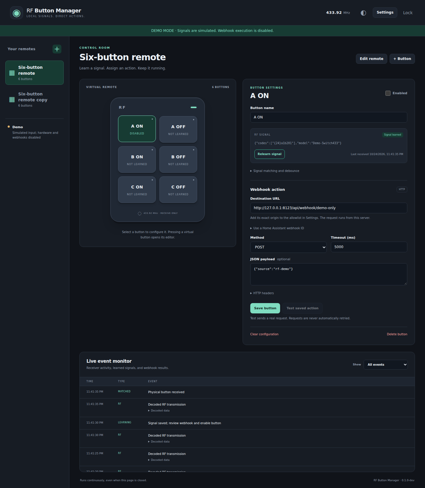

# RF Button Manager

Receiver selection: use **Settings → Receiver device** to choose one connected
RTL-SDR by unique serial. The dashboard identifies the active tuner and shows
decoded RF activity. See [receiver selection and limitations](docs/RECEIVERS.md)
for multiple tuners, duplicate serials and preservation of existing mappings.

Receive 433.92 MHz remote-control buttons with a native Linux service, learn supported
signals in a browser, and assign each button an HTTP webhook. Reception and actions
continue when the browser is closed. No MQTT broker, Docker container or cloud
account is required. This application receives signals; it does not transmit RF or
reprogram remotes.

**Development build.** Automated software tests do not establish physical USB
reliability. Receiver recovery and the intended remote/webhook combinations must pass the [hardware acceptance matrix](docs/HARDWARE-TESTS.md)
before this build can be called a production release.

**Compatibility is model-specific.** Three home switches are operator-reported
working; that does not establish support for every Amazon product or every
433 MHz remote. Read the [compatibility matrix and inspection guide](docs/COMPATIBILITY.md).



[Mobile interface preview](docs/screenshots/mobile.png). These screenshots use
synthetic RF data and demonstrate the actual application, not physical receiver tests.

## What it provides

- A six-button remote layout, plus additional remotes and custom button counts.
- Learn/relearn with three separately armed matching presses and final confirmation.
- Inspect signal without creating a remote: display the decoded identifier,
  compare three presses, and download an RF-only inspection report/capture.
- Global webhook suppression during learning, duplicate-mapping checks and debounce.
- Per-button GET/POST webhooks, headers, JSON payload, timeout and explicit test action.
- Receiver state and recent signal/action events, light/dark themes and mobile layout.
- Persistent SQLite configuration and authenticated configuration backup/restore.
- Native supervision of `rtl_433`, USB rediscovery and bounded restart backoff.
- Loopback binding and a management token by default.

Learning is entirely browser-driven: choose **Learn**, press/release the button,
verify three separate presses, then **Confirm and save**. Button events decoded by rtl_433 are learned directly, including common
EV1527, PT2262 and HT680 event formats. For supported 12–64 bit fixed-code OOK PWM/PPM/PCM signals, the application captures
pulses, derives measured timing candidates, and validates them with rtl_433 replay.
A suggestion alone is never saved. Unrecognized traffic is ignored within a bounded press window. Rolling/encrypted
codes and ambiguous or changing identities cannot be saved as fixed buttons. This is
not universal RF learning. See [the learning workflow](docs/LEARNING.md).

## Requirements and supplied binary

The supplied package targets Linux x86_64. Native installation needs systemd,
udev, the existing `rtl_433` executable (initial target 23.11), and a supported
RTL-SDR and a remote using a supported signal format. Runtime state belongs on
reliable internal storage. A browser is the management client; no Node server,
Go compiler, Docker container or MQTT broker is required to install the binary.

After verifying the outer archive's published SHA-256 and extracting into a fresh
directory, enter `rf-button-manager` and run:

```sh
sha256sum -c SHA256SUMS
test -x bin/rf-button-manager || chmod u+x bin/rf-button-manager
./bin/rf-button-manager --version
bash scripts/inspect-zorin.sh
bash scripts/install.sh --binary "$PWD/bin/rf-button-manager"
```

The packaged `SHA256SUMS` covers the binary and included update artifacts; the outer archive checksum covers the
complete package. Review the dry run and receiver ownership, then follow
[installation](#install-on-zorin). Use the supplied executable; rebuilding is only
needed for development or an intentional source change. To attach bundled history
without overwriting extracted source, follow the [developer guide](docs/DEVELOPMENT.md).

## Update an existing installation with a prebuilt package

Extract the new archive to a fresh directory on the internal disk. Close learning
and leave actions disabled in the GUI, then run from the extracted project:

```sh
sha256sum -c SHA256SUMS
sudo python3 scripts/update-prebuilt.py --apply
```

No Go installation or rebuild is involved. The helper snapshots stopped state and
the old executable, replaces only the application executable, checks the **live**
HTTP version and 20 seconds of stable operation, and verifies authentication and
configuration/token/environment preservation. It restores the old binary and state
if verification fails. It does not modify the service unit, USB rule, firewall or
other services. Full source and history are included separately in the bundle;
this update does not overwrite your existing development checkout.

## Build and verify from source

Build on Linux with **Go 1.27.3**, Git and Make. The frontend controller tests
in `make check` additionally use Node.js 20 or later (no npm packages). The embedded frontend needs no Node
build or network-hosted assets. Tests with the race detector require a C compiler;
the release executable uses pure-Go SQLite and is built with `CGO_ENABLED=0`.

```sh
go mod download
go mod verify
make check
make build
./bin/rf-button-manager --version
```

`rtl_433` is also needed for the offline pulse replay integration tests (CI installs
it). Those tests never open USB; without it they report a skip.

`make test` runs uncached race-enabled tests with a two-minute timeout per package.
Use `make test TEST_PACKAGES=./internal/receiver` for a targeted check, or override
`TEST_FLAGS` deliberately. `make test-deploy` verifies shell syntax and dry-run
behavior without installing anything. These checks do not use production data or
establish physical receiver behavior.

`go.mod` and `go.sum` pin the dependency graph and checksums. `make build` uses a
fixed target (`linux/amd64`), strips machine paths/build IDs and excludes VCS metadata.
Reproduce a binary with the same commit, toolchain and command; verify it with
`sha256sum bin/rf-button-manager`. Dependency downloads require internet access on
the build machine. Runtime decoding still uses an installed `rtl_433` executable.

## First local run

```sh
./bin/rf-button-manager --data-dir ./rf-data --listen 127.0.0.1:8787 --rtl433 /usr/bin/rtl_433
```

Open `http://127.0.0.1:8787` and enter the token from
`rf-data/management.token`. Keep the token private. A missing receiver is reported;
demo data is never substituted automatically. Without explicit decoder settings,
rtl_433 uses its default protocols. Learn discovers supported unknown PWM/PPM/PCM
profiles automatically; a connected receiver alone does not prove a button decoded.

For an interface preview without radio hardware, use a **separate** data directory:

```sh
./bin/rf-button-manager --demo --data-dir ./demo-data
```

Demo mode explicitly labels simulated receiver data, generates synthetic
`Switch433` events every five seconds and disables all real webhook execution.
It cannot verify your radio, decoder or Home Assistant installation.

1. Check receiver status. Select its unique serial in Settings if necessary.
   Normal learning does not require custom decoder settings.
2. Add a remote with six buttons and two columns.
3. Select **A ON**, choose **Learn**, wait for the receiver-ready instruction,
   and briefly press/release the matching physical button once.
4. Inspect the received candidate. Release the button, arm the next capture, and
   repeat until three separate presses match. Confirm and save the mapping and
   validated profile. Keep actions disabled until deliberate action testing.
5. Paste the complete URL copied from Home Assistant into **Webhook URL**.
   If you only have an ID, expand the optional Home Assistant helper; it accepts
   either an ID with a base URL or a complete URL.
6. Click **Save button**, or **Save & allow destination** for a new server address.
   The editor shows the exact address being allowed. Saving does not send a test
   request; the button and destination permission are saved together.
7. Use **Test saved action** deliberately, then enable the button and test a physical press.

Home Assistant must already contain the intended webhook automation. This app does
not create or change Home Assistant automations. Home Assistant enables POST by
default; GET requires explicit `allowed_methods` configuration there. Treat the
webhook ID as a secret. Use state-setting actions where possible; a network timeout
cannot tell whether an action executed, so this app does not automatically retry it.
At most eight requests run concurrently across different buttons, and each button
can have only one pending request. Extra presses while that button or the global
limit is busy are rejected and logged; they are not queued for delayed execution
or replayed after restart.

## Install on ZORIN

First review the [operations guide](docs/OPERATIONS.md) and run the read-only
inspection script. Do not change the production server until the intended changes
have been reviewed and approved.

```sh
bash scripts/inspect-zorin.sh
bash scripts/install.sh --binary "$PWD/bin/rf-button-manager"
# Only after reviewing the dry-run plan and approving deployment:
sudo bash scripts/install.sh --binary "$PWD/bin/rf-button-manager" --apply
```

The installer creates only RF Button Manager's service, service account, state
directory, executable and narrowly scoped USB permissions. It does not install
packages, modify kernel modules, stop competing receiver services, or change Docker
and Home Assistant. If initial USB permissions have not applied, arrange a
receiver-only reconnect with its operator. Never reset hubs or other devices.

From Windows, keep the default private listener and forward it through SSH:

```powershell
ssh -N -L 8787:127.0.0.1:8787 nino@ZORIN
```

Then open `http://127.0.0.1:8787` in the Windows browser. Retrieve the login token
on ZORIN with `sudo cat /var/lib/rf-button-manager/management.token`.
For direct private-network access, see the explicit binding and HTTPS guidance in
the operations guide. No public exposure is configured by default.
An HTTPS reverse proxy also requires the exact trusted browser origin through
`--public-origin https://rf.home.example` (replace the example with your own origin),
or `RFB_PUBLIC_ORIGIN` in the installed environment file. Without that setting,
strict same-origin checks reject an HTTPS frontend backed by loopback HTTP.

## Project documentation

- [Architecture and technical risks](docs/ARCHITECTURE.md)
- [Receiver configuration and three-press learning](docs/CONFIGURATION.md)
- [API contract and authenticated examples](docs/API.md)
- [Installation, upgrades, backups and troubleshooting](docs/OPERATIONS.md)
- [Physical hardware release gate](docs/HARDWARE-TESTS.md)
- [Persistent implementation progress](docs/PROGRESS.md)
- [Clean builds and developer extension examples](docs/DEVELOPMENT.md)
- [Contributing and forking](CONTRIBUTING.md)
- [Security and private configuration](SECURITY.md)
- [Publication and release procedures](docs/RELEASING.md)

## License and dependencies

Application code: [MIT](LICENSE), copyright Nino Milin. `rtl_433` is a separately
installed project with its own license and source at
<https://github.com/merbanan/rtl_433>. Go dependencies retain their own licenses;
run `python3 scripts/collect-notices.py` when packaging a binary to collect their
license texts and the Go standard library notices into
`dist/THIRD_PARTY_NOTICES.txt`. Include that file and the application's `LICENSE`
beside every distributed executable.

Sources: [rtl_433 operation](https://triq.org/rtl_433/OPERATION.html),
[Home Assistant webhook triggers](https://www.home-assistant.io/docs/automation/trigger/#webhook-trigger),
[modernc SQLite](https://pkg.go.dev/modernc.org/sqlite).
