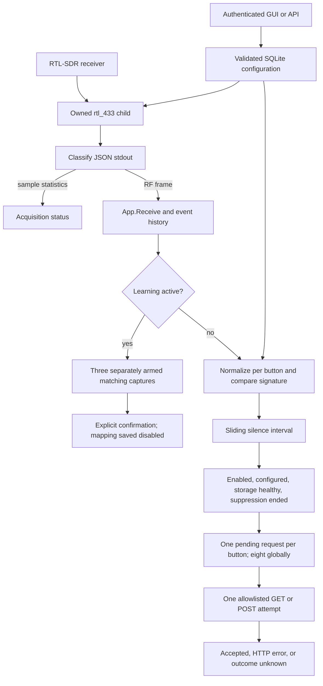

# RF Button Manager architecture

Status: development implementation. Physical acceptance is tracked separately in
[HARDWARE-TESTS.md](HARDWARE-TESTS.md); software tests do not establish USB reliability.

## Decisions

Go 1.27, standard net/http server, modernc.org/sqlite (pinned pure-Go SQLite),
embedded HTML/CSS/JavaScript with no CDN or frontend build tool. One Linux executable
manages one live rtl_433 child plus at most one file-replay child, listens on loopback by default, and persists configuration
and bounded event history in SQLite. Native systemd unit, no Docker or MQTT dependency.
MIT license for our code; rtl_433 is installed separately and retains its own license.

## Components

- cmd/rf-button-manager: flags, startup, shutdown and single-instance lock.
- internal/app: SQLite, configuration validation, learning, debounce, webhook dispatch and API.
- internal/receiver: Linux USB discovery, supervised live rtl_433, bounded pulse capture and offline analysis/replay.
- internal/webui: embedded remote editor and live monitor.
- deploy, scripts: systemd, install/uninstall, read-only ZORIN inspection.
- docs: architecture, API, operations, hardware acceptance and persistent progress.

## RF and recovery

Use explicit argv (never a shell), -c /dev/null to avoid unrelated rtl_433 configs,
JSON stdout, 433.92 MHz, configured protocol IDs and/or exact flex spec. Never guess
Switch433 timings: old analyzer output is not proof of the final tested decoder.
Canonical signatures include model and explicitly selected stable fields; metadata
(timestamps, signal level, counters) cannot be identity by default. Flex code arrays
must be normalized conservatively; uncertain multi-code events require diagnostics.
Learn is a timed global suppression session, requires three separately armed presses
of one candidate and explicit confirmation, and checks mapping uniqueness atomically.
No webhook dispatch during learning. Sliding silence-based debounce prevents a held
button from retriggering continuously. Actions are not replayed across restarts.

USB discovery re-runs across port/hub changes. Select unique serial where available;
automatic selection is permitted only with exactly one supported receiver. Ambiguous
receivers block acquisition. Never persist USB bus/device numbers. Supervise process
exit and USB disappearance independently of RF silence, with capped exponential
backoff, clean child termination and recovery events. Hardware tests remain a release
gate; synthetic subprocess/USB tests are not physical USB evidence.

## Security and actions

Loopback default, random persisted management token, bearer authentication, strict
same-origin checks for browser requests, request size limits and CSP. LAN access
requires an explicit private bind and token; use an SSH tunnel or HTTPS reverse proxy.
Webhook destinations are explicit HTTP(S) origins on an administrator allowlist;
no redirects, no environment proxy, no URL credentials, no unbounded retries.
POST is default. Exactly-once HTTP delivery is impossible: timeout means outcome
unknown; never automatically repeat a physical action. Secrets excluded from logs.
Backups contain secrets and are authenticated downloads; restore validates and
atomically replaces configuration with actions disabled pending review.

## Sources reviewed 2026-10-25

- https://triq.org/rtl_433/OPERATION.html — serial selection, JSON output, flex decoders, diagnostics.
- https://github.com/merbanan/rtl_433/tree/23.11 — target installed version.
- https://pkg.go.dev/modernc.org/sqlite — pure-Go SQLite.
- https://www.home-assistant.io/docs/automation/trigger/#webhook-trigger — POST and webhook semantics.

## Main risks

Unsupported or rolling-code protocols; incorrect flex timings; RF collisions and
false decodes; nonunique USB serials; decoder hangs without USB removal; slow webhook
destinations; uncertain HTTP outcomes; power-loss/disk-full storage failures; local
network management credential exposure. Tests and explicit limits document each.

## Source map and change boundaries

| Source | Responsibility and entry points |
| --- | --- |
| `cmd/rf-button-manager/main.go` | CLI validation, token creation, data lock, startup/shutdown, receiver configuration reload |
| `internal/receiver/receiver.go` | `Run`, device selection, argv construction, JSON classification, recovery state machine |
| `internal/receiver/linux.go` | Compatible USB ID table, sysfs enumeration, subprocess pipes and process groups |
| `internal/receiver/devices.go` | Display-only inventory and validation of an explicit serial selection |
| `internal/receiver/pulses.go`, `analysis.go`, `profiles.go`, `pwm.go`, `pcm.go` | Bounded pulse parsing, measured candidates, replay validation and immutable profile identity |
| `internal/receiver/offline_linux.go` | File-only replay worker, output bounds, cancellation and cleanup |
| `internal/receiver/unsupported.go` | Non-Linux guard |
| `internal/app/model.go` | JSON models, defaults, `Signature`, configuration/webhook validation, overlap checks |
| `internal/app/engine.go` | CRUD, learning entry points, persistence coordination, debounce, suppression and bounded events |
| `internal/app/learning.go`, `decoded_learning.go` | Capture state machine, receiver generations, background analysis and decoded-event identities |
| `internal/app/inspection.go`, `capture_export.go` | RF-only report/capture exports without configuration or webhook fields |
| `internal/app/store.go` | SQLite initialization, configuration replacement and event retention |
| `internal/app/webhook.go` | Delivery, safe DNS/dialing, deadlines, bounded concurrency |
| `internal/app/http.go` | Routes, authentication, browser-origin checks and strict JSON decoding |
| `internal/webui/embed.go` | Embeds `static/` into the executable |
| `internal/webui/static/` | HTML, CSS and vanilla JS with one-second authenticated state polling |
| `internal/webui/ui.test.cjs` | Optional browser integration tests against an isolated demo process |
| `internal/webui/learning.test.cjs` | Node controller checks against an in-memory DOM/API adapter |
| `deploy/`, `scripts/` | Native installation, inspection, recovery and release tooling |
| `.github/workflows/ci.yml` | Pinned-toolchain Linux tests, vet, formatting and build |

## Complete processing path



`main.run` validates the listener, creates the private data directory, takes a
nonblocking `flock` on `instance.lock`, loads/creates the token, opens the store and
constructs `App`. A second process using that directory fails. SIGINT/SIGTERM
cancel reception, shut down HTTP, cancel pending actions and close storage. The
systemd unit's `KillMode=control-group` additionally contains descendants.
The embedded frontend is an ordinary API client; RF actions never rely on a tab.

## Receiver lifecycle details

Discovery includes every ID in `rtlUSBIDs`; the supplied udev rule grants access
only to `0bda:2832` and `0bda:2838`. Discovery support is not a permission grant.
Without a configured serial, exactly one compatible receiver is required. Its
nonempty serial is preferred over an index; index `0` is used only for a singleton
without a serial. A factory serial such as `00000001` is not globally unique.

The child command is built as separate arguments, not passed through a shell:

```text
rtl_433 -c /dev/null -d :SERIAL -D quit -f 433.92M \
  -F json -F log:/dev/stderr -M stats:1:10 \
  [-R 0] [-R PROTOCOL_ID ...] [-X EXISTING_FLEX_SPECIFICATION] \
  [-X VALIDATED_PROFILE ...] [-w OOK:- during learning]
```

`-R 0` is added when explicit protocols or a flex decoder are configured. With
both empty, rtl_433 uses its built-in defaults; this does not establish Switch433
support. Learned profiles append `-X` without disabling built-ins when legacy
settings are empty. The manager never inherits another program's config file.

Discovery runs every second. USB paths, bus numbers and device numbers are only
in-memory incarnation observations, never persisted selectors. Removal, changed
incarnation or ambiguity stops the child before reacquisition. Recovery starts
with a one-second delay, doubles up to 30 seconds and resets after one stable
minute. A missing sample heartbeat for 45 seconds causes a restart. Ordinary RF
silence does not. `recovering` means a child is starting; `connected` requires
recognized statistics, RF JSON or captured pulses, not simply successful process creation.

Stdout carries JSON and, during learning, `-w OOK:-` pulse records; stderr is drained independently and a bounded sanitized last
diagnostic is available on child failure. It never enters learning. Scanner lines
are limited to 256 KiB; RF application input to 64 KiB. Shutdown sends SIGTERM to
the dedicated process group, waits two seconds, then escalates to SIGKILL if
necessary. Parent-death signaling adds containment. None of this substitutes for
physical reconnect evidence.

## Concurrency and consistency

`App.mu` protects configuration and bookkeeping. Mutations clone, validate and
save configuration before exposing it. `actionGate` makes learning wait for
already-running requests, then excludes new dispatches. An epoch invalidates
stale scheduled work across configuration edits and learning transitions. A
request that has already reached a destination cannot be undone.

Automatic learning has a 180-second session limit, 30 seconds to acquire the
receiver, a fixed 20-second window per armed press including analysis, and a 6-second
continuous RF activity limit. Live decoded identities take the direct learning
path and can cancel unrelated background analysis. Otherwise it collects complete
pulse packets until 350 ms quiet or 1.2 s of collection, then replays measured
candidates. Both paths require three separately armed matching presses and confirmation. The demo retains its 90-second decoded-event path. Cancel/failure/
timeout preserve previous mappings. A timer drives cleanup even with no browser.
Unrecognized or mismatched recordings return to waiting in that same window, with
per-capture rejection metadata. They never reset deadlines, advance press count,
overwrite the verified candidate, or rearm learning. At most 40 analysis starts per window, at least 500 ms apart, bound background
work. Short bursts are filtered before analysis. Live decoded events remain eligible
until the same deadline even after the pulse-analysis budget is exhausted. Analysis receives a context clipped to the original
window deadline, and late results cannot become candidates. Receiver/decoder-process
failure remains terminal. See [BACKGROUND-LEARNING.md](BACKGROUND-LEARNING.md).

The receiver plan carries a generation. The supervisor cancels and waits for the
old live process before applying a replacement. An acknowledgement from an older
plan cannot resume actions. `captureSuppressed` remains set until both the normal
receiver plan is acknowledged and the offline analysis worker has finished cleanup.
Cancelled/expired sessions discard late results. The offline child is restricted
to `-r` file input and never selects USB. See [LEARNING.md](LEARNING.md) for the
full pipeline, profile contract and bounds.

Startup suppresses RF actions briefly and leaving learning adds one second.
Per-button sliding debounce is 700 ms by default. Pending requests, debounce
timestamps and learning are not durable queues; nothing replays after restart.

Each button gets one pending action slot and there are eight globally. Busy
presses are rejected and logged. Dispatch rechecks configuration epoch, learning,
enabled state and storage health, records intent, then makes one HTTP attempt.
See [CONFIGURATION.md](CONFIGURATION.md) for identity and operator details.

## Storage contract

SQLite uses one connection, WAL, `synchronous=FULL` and a 5,000 ms busy timeout.
The `configuration` table contains one JSON value (`id=1`), while `events` stores
JSON with monotonic IDs. Logical configuration has `schema_version=2`; schema 1 migrates on validated open/restore. There are
at most 500 stored events and 150 recent events in API state. Raw event data over
8 KiB is omitted from history. This is operational history, not an unlimited audit
archive of every RF transmission.

Configuration, mappings, validated decoder profiles, token and bounded history persist. Receiver status,
learning, action slots and debounce timestamps do not. Logical restore validates
the whole configuration, disables all restored actions and clears their
`last_received` values; it does not restore the token or event archive. Corrupt
configuration is rejected instead of replaced. A configuration/event write error
sets `storage_error` and pauses actions until the fault is fixed and the service
restarted. Never directly edit SQLite; use the API or a stopped-state restore.

## Scope limits

One receiver, fixed 433.92 MHz reception, static identities, HTTP GET/POST actions,
one administrative credential, no per-user roles, no TLS server, no action queue
and no automatic retries. RF is unauthenticated/replayable. HTTP 2xx establishes
acceptance by an endpoint, not a physical outcome. See [DEVELOPMENT.md](DEVELOPMENT.md)
for extension examples and [RELEASING.md](RELEASING.md) for release gates.
