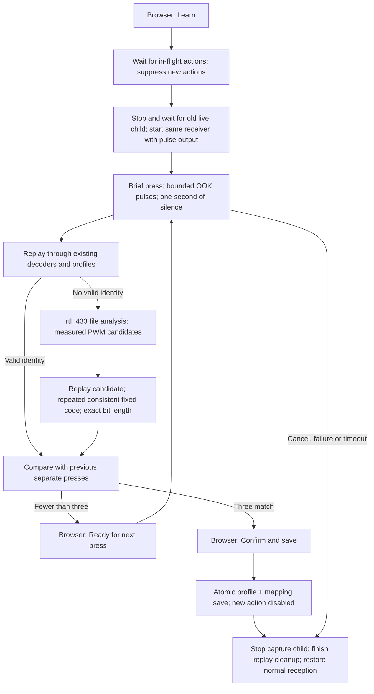

# Browser learning and measured decoder profiles

Normal operation is through the browser. Select a button, choose **Learn**, wait
for the receiver-ready instruction, briefly press/release the physical button,
repeat when prompted, and **Confirm and save**. No terminal history, decoder string,
configuration file or receiver command is needed. Existing remotes, mappings and
advanced decoder settings are preserved. New mappings stay disabled.

## What is supported

The application first reuses a profile associated with the remote, then tries
existing configured/default rtl_433 decoders and other saved profiles. A decoded
identity must satisfy the existing stable model/device/button rules.

When those decoders cannot identify a capture, automatic profile discovery supports
**fixed-code OOK/PWM, 16–64 bits**, at the application's fixed 433.92 MHz frequency.
It requires repeated RF rows inside a capture and the same identity across three
separately armed physical presses. A continuous hold cannot supply three presses.
Keep other remotes idle: the application cannot know which physical transmitter
you intended, and the final review remains necessary.

Analyzer suggestions are candidates only. The app never installs stock timings
for “Switch433,” chooses the first arbitrary code, or claims universal learning.
FSK/PPM and other modulation discovery, rolling/encrypted codes, captures without
stable repeated frames, and ambiguous interpretations are unsupported. Three
matching observations do not prove that an unfamiliar protocol can never change
its code. Physical evidence for a particular remote is tracked separately.

## A ON: the operator flow

1. Select **A ON** in the existing six-button remote. Save any pending editor edits
   and click **Learn signal**. All webhook actions pause, including explicit tests.
2. Wait for **Press the physical button once**. Briefly press physical **A ON** and
   release it completely. The dialog shows **Transmission detected**, then
   **Checking the captured signal**, then **1 of 3 matching presses**.
3. After release and one second of silence, select **Ready for next press**. Press
   and release the same physical button once. Expect **2 of 3**.
4. Arm again and make the third separate press. Expect **Ready to save / 3 of 3**.
5. Review the candidate and choose **Confirm and save**. Decoder profile and button
   mapping are saved together. The action stays disabled. Later buttons on this
   remote preferentially reuse the profile and still need three separate presses.

Cancel preserves the previous mapping. Failed attempts retain a visible explanation,
**Retry learning**, and **Diagnostics and receiver status**. Retry becomes available
after normal reception is restored. It starts a new attempt with zero captures.
The browser may be closed; a server timer still expires and cleans up learning.

| Visible state | Meaning / next step |
| --- | --- |
| Preparing receiver | The manager is changing its own receiver process to capture mode. Wait. |
| Receiver unavailable | USB/sample acquisition failed or was lost. Inspect receiver status; retry after recovery. |
| Waiting for transmission | Samples are available; briefly press/release the intended button. |
| Transmission detected | Pulses arrived; release and allow RF silence before analysis. |
| Checking captured signal | rtl_433 is replaying a private recording; do not press again yet. |
| No pulse capture | No usable pulse recording reached analysis. Decoded JSON or a sample heartbeat alone is not capture proof. |
| Malformed pulse capture | A header, timing row, count or packet boundary was invalid. Diagnostics retain the specific parser rejection; no compatibility conclusion is made. |
| No supported modulation captured | Only FSK packets were observed in the armed window. They may be unrelated traffic; the intended remote has not been identified. |
| Capture has no validated decoder | Complete OOK input reached replay, but no supported interpretation passed validation. This is different from an empty or malformed stream. |
| Capture stream failed | Reading stdout failed or a line exceeded its limit. Inspect the retained stream error. |
| Inconsistent captures | Different identities or ambiguous frames appeared. Keep other remotes idle and retry the same button. |
| Capture limit / session timeout | Prolonged RF activity, the overall session deadline, or a resource limit prevented completion. |
| Ready to save | Three separate captures agree. Review and confirm; actions stay disabled. |

Diagnostics separately show the capture receiver's last observed status and the
current reception status/mode. After failure, current **connected** can describe
restored normal reception. It does not prove the failed capture succeeded.
Observed packets/pulses/bytes are counted before rejection, separately from packets
accepted for replay. Stdout bytes/lines, JSON records, headers, end boundaries,
incomplete rows, modulation and rejection counts explain where input stopped.
The original failure reason remains fixed while late cleanup evidence is added.
Bounded metadata is saved in event history, including when the dialog is dismissed.
Raw IQ, tokens and webhook configuration are not included. Decoded identifiers in
other state fields can still identify a remote: review before sharing.

## Capture, analysis and validation

The live process uses `-w OOK:-` alongside JSON output. In rtl_433 23.11 this output
includes **both OOK and FSK** packets. The parser separates complete JSON objects,
stream metadata, and `;ook N pulses` / `;fsk N pulses` packets ending in `;end`.
Version 1, an explicit 1us timescale, matching row counts and bounded integer timing
pairs are required; malformed input is never repaired by guessing units or timings.
Valid FSK traffic is counted and excluded while OOK learning continues to wait.
Learning does not count live JSON as capture proof. A quiet interval closes each
press recording. The application replays it with `rtl_433 -r PRIVATE_FILE`, never
another USB selector. See [CAPTURE-INVESTIGATION.md](CAPTURE-INVESTIGATION.md) for
the 0.2.0 diagnostic failure and the actual 23.11 IQ-stream regression evidence.

When needed, `-A -R 0` produces timing candidates. The parser accepts only measured
numeric `m=OOK_PWM,s,l,r,g,t,y` values within bounds. Probe replay requires 16–64
bits and at least two repeated rows. Multiple distinct eligible codes are rejected.
An accepted candidate is narrowed to its exact measured bit count, replayed again,
and then used unchanged for the second and third presses. A profile is not persisted
until final confirmation and overlap validation succeed.

Profile IDs/models derive from a hash of canonical timing and framing, not an RF
button code. Different buttons can share a profile. Runtime normalization retains
the exact model and code; shorter delimiter rows can be excluded only after the
profile bit count has been fixed. Existing custom decoder behavior is preserved.

## Ownership, limits and cleanup

There is at most **one live USB-owning rtl_433 child** and **one file-replay child**.
The receiver supervisor waits for process-group and pipe cleanup before starting
a replacement live child. Each plan carries a generation; stale acknowledgements
cannot clear suppression. File replay uses explicit argv, private mode-0600 data
inside a mode-0700 scratch directory, and no shell. The supplied systemd unit's
private `/tmp` is on internal storage; captures are not written to the backup disk.

| Bound | Limit |
| --- | --- |
| Overall automatic session | 180 seconds |
| Receiver preparation | 30 seconds |
| Waiting per armed press | 20 seconds |
| Continuous RF activity per capture | 6 seconds |
| Quiet interval between capture and analysis / rearming | 1 second |
| One press recording | 32 packets, 256 KiB total; 4,096 pulse pairs per packet |
| Session stream | 2 MiB / 128 observed packet records, checked at progress callbacks |
| Offline analysis | 10 seconds total, 2 seconds per child |
| Child output | 512 KiB stdout, 128 KiB stderr; bounded individual lines |
| Distinct analyzer candidates | 8 |
| Saved profiles | 16 |

The replay process group is terminated/reaped on cancellation or timeout. Scratch
files are removed after analysis, including failure. On abrupt process death,
parent-death signaling and systemd control-group cleanup stop children; the service's
private temporary directory is discarded on stop. Learning state does not survive
a restart, and no provisional mapping is recovered or silently accepted.

Cancel, timeout, receiver loss and failure request restoration of the normal
receiver plan. All webhook execution remains suppressed until the old capture
child and the replay worker have finished cleanup. Existing enabled actions are
preserved and may resume after restoration; newly learned actions stay disabled.
The stopped child's already-read queue is drained for diagnostics. Partial packets
produce a specific missing-boundary rejection. Data read during shutdown is never
eligible as a new candidate. Counts describe records read by the supervisor, not
unread bytes still in OS or device buffers when a child is terminated.

## Storage and upgrade compatibility

Schema 2 adds top-level `decoder_profiles` and button `decoder_profile_id`. The
existing settings object remains compatible with its full-object PUT API. Profiles
are immutable through ordinary settings/button edits, persisted atomically with
confirmed mappings, and included in authenticated logical backups. Restore validates
profiles and references and disables restored actions. No direct SQLite editing is
part of the workflow.

Schema-1 configurations/backups migrate without losing existing data. An older
0.1 executable rejects schema 2. Preserve a stopped pre-upgrade state snapshot for
rollback; see [OPERATIONS.md](OPERATIONS.md). Do not downgrade only the executable
after migration and expect the old application to accept new data.

## Evidence and extension points

`internal/receiver/analysis_test.go` replays an explicitly synthetic pulse fixture
through an installed rtl_433 without USB. Application tests cover lifecycle,
timeouts, inconsistent captures, late results, collisions, persistence and profile
reuse. The supervisor test holds cleanup open to prove a replacement live process
cannot start early. These are software tests, not physical button or USB tests.

Receiver compatibility, actual A ON learning, other buttons, physical webhook
effects and USB port/hub recovery remain separate operator-assisted tests. A
supported software path does not establish success for the user's actual remote.
For extensions, read [DEVELOPMENT.md](DEVELOPMENT.md).

Upstream references: [rtl_433 operation](https://triq.org/rtl_433/OPERATION.html),
[pulse analysis](https://triq.org/rtl_433/ANALYZE.html), and the
[23.11 source](https://github.com/merbanan/rtl_433/tree/23.11).
